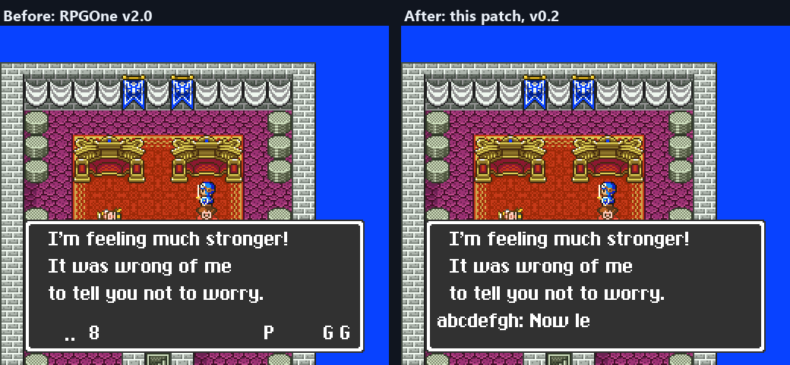
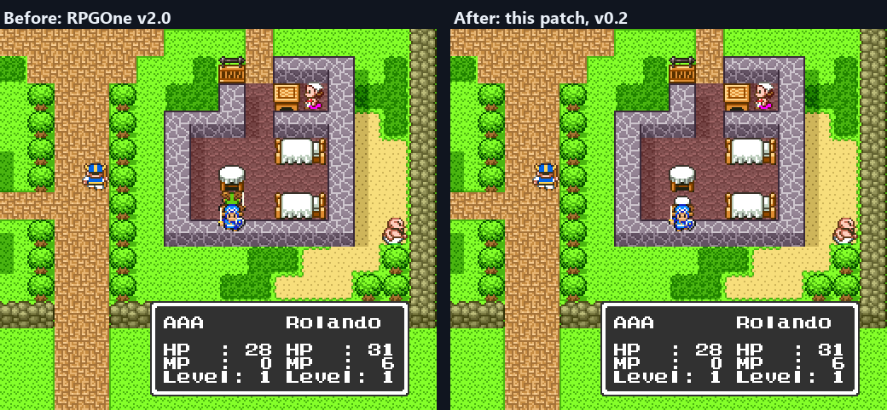
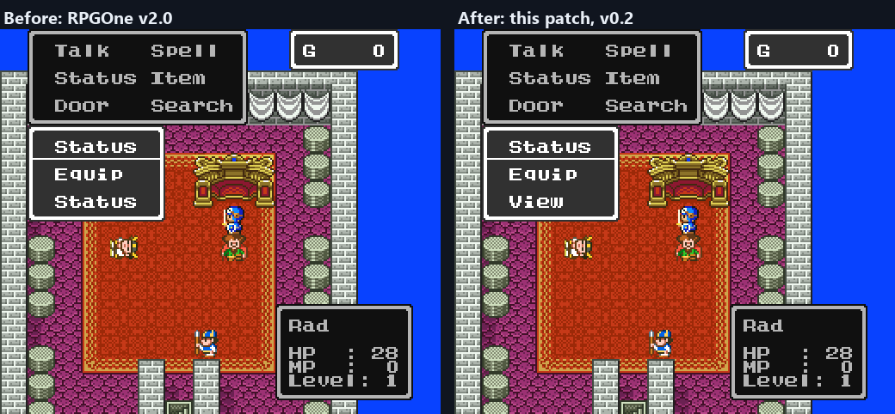
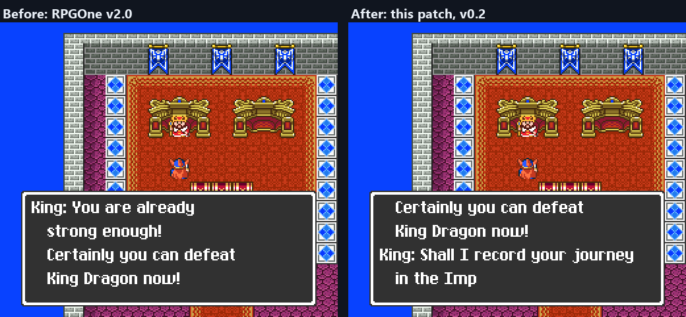
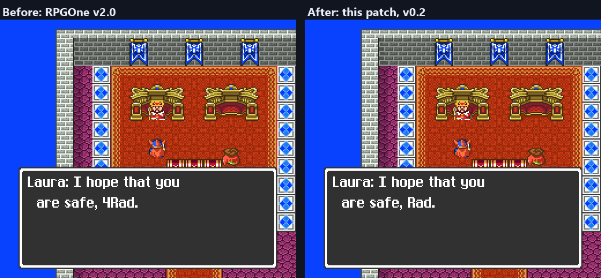
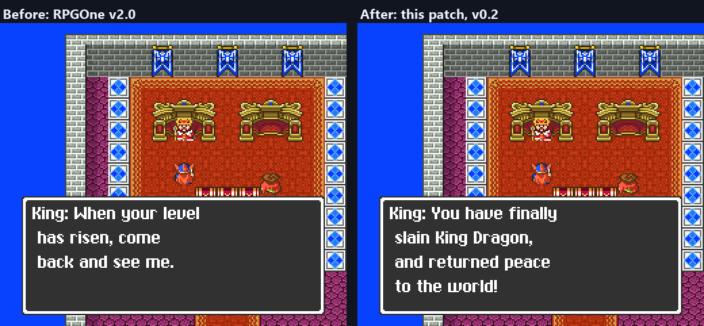
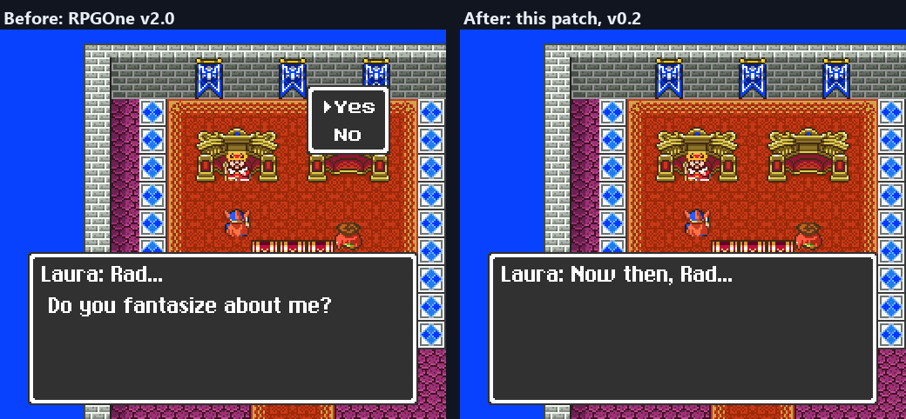

# Dragon Quest I+II (SFC) English, Fixed

One patch for the original Japanese *Dragon Quest I+II* (Super Famicom) that applies
RPGOne's English translation v2.0, mziab's title screen fix, and my fixes for the bugs
players have reported in that translation, including the Leaf of the World Tree
softlock in Dragon Quest II.

If you know Rod Mérida's DQ1n2Fix patch (2021, DQ names only): since v0.3 this patch
also fixes most of the bugs his patch fixes, such as the endless conversations after
Hargon, the princess's name changing in the Item menu, the second prince with a party of
three, the vault amounts and the Beran inn price. It also fixes bugs that are still in
his patch: the Echoing Flute after the first crest, the Chance spell, and the Dragon
Quest I Dragonlord's transformation text. His renames, name generator, splash screens
and font changes are not part of this patch. See [Credits](#credits).

---

## Most of this is someone else's work

**RPGOne Translations and EvilTeam Traduções translated these games.** Every line of
English you read is theirs. Their full credits, from their v2.0 readme, are listed
under [Credits](#credits) at the end of this page.

**mziab fixed the broken Dragon Quest I title screen in 2012.** That fix is his. It is
included unchanged, byte for byte, and this patch applies it before anything of mine.

Their wording is kept. The exceptions are listed below: a stray digit in the Princess's
Love message, a new menu word, "View", in the Dragon Quest II Status menu, and in v0.3
spelling mistakes, names that disagree with the same flavor's own item list or with the
rest of its script, and a few broken lines rebuilt from RPGOne's own wording. In v0.4:
the companions' names and three item names in the DQ flavor. Everything else I changed
is code, pointers, control bytes, line breaks, or which name a line prints.

---

## What this patch fixes

Each fix below says what you see, why it happens, and what I changed. "Both flavors"
means the DQ and DW versions of the translation; a few bugs exist in only one of them.

The screenshots show the DQ flavor in Mesen 2, with the hero named Rad: RPGOne v2.0 with mziab's fix on the left,
this patch on the right. Some were taken with a test build that starts the message directly,
so the scene around the text is not always where it happens in the game.

### Dragon Quest II: the Leaf of the World Tree softlock (both flavors)

**What you see.** After the Prince of Cannock falls ill at the Beran inn, feeding him
the Leaf of the World Tree starts his recovery speech, then the text box loops forever
or the screen goes black, and the game has to be reset. Reviews tied it to his name being longer than 4 letters.

**Why.** The game builds each message into a 256-byte buffer and draws it with an
8-bit index (`INC $C9` at `$00:B22F` and elsewhere), so anything past byte 255 wraps
back to byte 0. The Japanese text never came close. The English recovery speech names
the prince four times and the hero once before RPGOne's split, which they added to stay
under the limit, but the split itself sits right at the edge. With the hero named "AAA",
"Kain" ends it at byte 245; "Rolando" puts its last two bytes at 256 and 257, the game
reads the jump address from the start of the buffer instead, and it loops. In the DQ
flavor it overflows once four times the prince's name plus the hero's name reaches 30
letters: Rolando or Anthony with almost any hero name, Arthur or Square with a hero
name of 6 letters or more. Kain and the 5-letter names never reach it on their own,
but in v2.0 the swap bug described below can lengthen the hero's printed name during
the illness, which pushes more combinations over.

**What I changed.** I moved RPGOne's split earlier in the same message, to the page
break after "has recovered!", and shifted the text between the old and new split by
five bytes. Nothing outside the message moves. With 8-letter names for everyone, the
two parts now come to at most 168 and 149 bytes.



### Dragon Quest I: the Dragonlord (DQ flavor; corrected in v0.3)

**A correction first.** Versions 0.1 and 0.2 of this page said that the Dragonlord's
offer looped and printed "What do you say,51,, boy?", and that this patch fixed it.
That is true of a copy of his speech in bank `$01` (`$01:CB37`), but the game never
shows that copy. The conversation you actually have is RPGOne's version in bank `$32`
(`$32:E518` DQ, `$32:E5CC` DW), and it already works in v2.0. The v0.1 change to the
unused copy is harmless and stays in the patch, but it fixed nothing a player could see.
The screenshot that showed it came from a test build and has been removed.

**What you see.** If you refuse his offer twice, the text between the two battles is a
fragment of his "accept" speech ("u half of the world of darkness! Now your journey is
over... WA HA HA HA!"), and none of the transformation's sound effects play.

**Why.** The game finds that text through a pointer in the code (`$00:9186`). RPGOne
moved the scene to bank `$32` and updated the pointer in the DW flavor, but in the DQ
flavor it still points at the Japanese address, where other text now sits. RPGOne's DQ
translation of the scene (`$32:EA3E`) was never shown, and its line breaks were never
finished.

**What I changed.** The pointer now leads to a copy of RPGOne's DQ scene ("King Dragon's
form gradually disappears... What! King Dragon's true form is revealed!") with the line
breaks of their DW version. The story flags and sound effects are the Japanese game's.

### Dragon Quest II: names swapped while the prince is sick (both flavors)

**What you see.** While the prince is ill, people talk about "Prince Linda", his
father says the princess has been cursed, and the hero's name can grow extra letters
on the end. Item messages can name the wrong party member.

**Why.** When the prince falls ill the game swaps his party slot with the princess's,
including their names. RPGOne widened names from 4 letters to 8 and moved them, but
three things were left behind:

1. The swap routine (`$1B:A521`) still swaps 5 bytes at the old Japanese addresses
   `$0176` and `$017B`. In the new layout those bytes are the end of the hero's name
   and the start of a copy of the prince's, so a hero named `ABCDEFGH` turns into
   `ABCDEolandFG` during the illness.
2. The Japanese script names the prince by who he is (a fixed copy at `$0189` that
   never swaps). About 30 of those lines were changed to his party slot (`$015F`),
   which holds the princess's name while he is ill. The DW flavor kept the right one
   in the sickbed scenes; the DQ flavor did not.
3. Two name lookups, the lead party member's name (`$09:994A`) and an item or spell
   target's name (`$00:BCAF`), mix slot names with fixed names, so they name the wrong
   person while the slots are swapped.

**What I changed.** I removed the 5-byte swap, since nothing needs those copies once
the readers use the 9-byte slot names. I pointed both lookups at the slot names, the
way the Japanese ones work. I changed the lines that mean the prince himself back to
`$0189`, as the Japanese script has them: 34 lines in the DQ flavor, 27 in DW. I left
the lines that really are about a party slot alone: battle messages, and the level-up
advice that shows that slot's experience.

### Dragon Quest II: the prince's name lost at a new game (both flavors)

**What you see.** With some hero names the princess is named Gloria or Samantha, and
then the prince's name prints as "ha" or as nothing in the Leaf scene, item messages,
and anywhere else that names him directly.

**Why.** RPGOne put a 9-byte copy of the princess's name at `$0183`, six bytes before
the prince's fixed name at `$0189`. A princess name of six letters or more runs past
it and overwrites the start of his name.

**What I changed.** That copy is no longer written; nothing reads it once the slot-2
text uses the princess's slot name. A new game with "Samantha" now keeps "Conan" intact.
Saves made with v2.0 keep whatever was stored; renaming the prince from the load
screen rewrites it.

### Dragon Quest II: a second Prince of Cannock (both flavors)

**What you see.** After the prince joins you at the Leftwyne inn, he can be standing in
the inn again while he is in your party, and talking to him plays his joining scene a
second time. RPGOne's readme calls this the "clone prince", partly fixed in v2.0.

**Why.** The King of Midenhall picks what to say with a list of checks. In the Japanese
script every case where the prince has already joined goes straight to "You've returned
safely" (`$14:802B`). RPGOne's pointers for those cases land five bytes early, on the
check before it. So once Cannock has told you that the prince left for Midenhall, the
King repeats "A short time ago, the Prince of Cannock came looking for you" and sets the
flag that puts the prince in the Leftwyne inn. There are four such pointers: a party of
two and the prince's illness (`$14:8004`, `$14:8024`), and two for a party of three
(`$14:81A2`, `$14:81A8` in the DQ flavor, one byte earlier in DW).

**What I changed.** Pointed all four at the greeting, as the Japanese script does.
v0.2 fixed only the first two and said the bug was gone; with the princess in the party
the King still repeated the speech. v0.3 fixes the other two. Visiting the King alone
after Cannock still gives you that speech, which is how the prince gets to Leftwyne in
the first place.



### Dragon Quest II: "Status" twice in the Status menu (both flavors)

**What you see.** The Status submenu lists Status, Equip, Status.

**Why.** RPGOne's line list for that window (`$31:8380`) points the third row at the
window's own title line. The Japanese option means "view strength".

**What I changed.** Added a line " View" in free space at `$31:FF00`, the same width as
the other rows, and pointed the third row at it.



### Dragon Quest I: no save at level 30 (DQ flavor)

**What you see.** At the maximum level the King says you are strong enough to defeat
the Dragonlord and never asks to record your journey.

**Why.** In the Japanese script that line ends with a wait and runs straight into the
save question. In the DQ flavor it ends the message instead (`$01:B8B1`). The DW
flavor has it right.

**What I changed.** That one byte, so it waits and continues into the save question.



### Dragon Quest I: a "4" before your name with the Princess's Love (DQ flavor)

**What you see.** "I hope that you are safe, 4Name."

**Why.** A stray `$05`, the digit 4, before the name in that line (`$01:8749`).

**What I changed.** Removed it.



### Dragon Quest I: the King's victory speech is skipped (both flavors)

**What you see.** Nothing, which is the problem: "You have finally slain King Dragon,
and returned peace to the world!" is translated in the ROM but never shown.

**Why.** The branch that leads to it (flag `$3B`, `$01:BD10`) points to the level and
save talk that follows the speech instead of to the speech. The Japanese branch points
to the speech.

**What I changed.** Pointed it at the speech.



### Dragon Quest I: the princess says goodbye twice (both flavors)

**What you see.** When you carry the princess back to the King, she gives you the
Princess's Love and says goodbye, then keeps talking with one of the lines she has for
later (such as "I will continue to support you" or "Do you fantasize about me?"), and
the kiss jingle can play again.

**Why.** In the Japanese script her farewell ends the message. In RPGOne its last line
ends with a wait instead of an end (`$01:C057` DQ, `$01:C07D` DW), so the game keeps
reading into the next message, a different set of her lines that the script reaches
on its own through another branch.

**What I changed.** That one byte, so the message ends where the Japanese one does. The
other branch still reaches those lines, as in the Japanese game.



### Dragon Quest I: the title screen (both flavors)

**The broken banner.** On real hardware and accurate emulators the DQ1 title shows
the Japanese banner, because RPGOne's routine copies the English tiles to video
memory while the screen is drawing, when the hardware ignores the writes. mziab's fix
splits the copy across four vertical blanks. It is included unchanged.

**The idle timer.** If you leave the DQ1 title alone, the Japanese game returns to
the attract sequence after about a minute. With RPGOne's patch it waits about 18
minutes. Their hook at `$2C:80FC` overwrote four bytes of a five-byte pair of
instructions and left the fifth behind, so the CPU ran it as a different instruction
and the wait loop started from 0 instead of 3,100 frames. I restored the missing
`LDY #$0000` in a small stub and turned the leftover byte into a `NOP`.

### Fixed in v0.3

For v0.3 I compared RPGOne's script with the Japanese one wherever a line can go wrong:
its control codes, pointers and the names it prints. Each fix below follows the
Japanese script, or RPGOne's own text in the other flavor or elsewhere in the same one.
Both flavors unless marked.

**Conversations that never end, or end too early (Dragon Quest II)**

- After Hargon, the Descendant's Orb asked its question forever: answering Yes ran on
  into the No text, which asks again.
- After Hargon, a nun repeated "Thanks to you, the people have been saved." forever (DQ).
- After Hargon, one villager line began with the end of an unrelated line ("...open that
  treasure chest!") in DQ, or with 32 blank spaces in DW.
- The curse-removal man's "Heh heh heh..." was drawn over the first line of his window.
- The King of Midenhall's "I can never count on you." and the thief's apology (DQ) ran
  straight into the next speech without waiting for a button.

**Spells and items (Dragon Quest II)**

- The Echoing Flute echoed only until the first crest was found, then never again at
  the other four crest sites.
- Chance: three of its eight outcomes broke. "The monsters flee" and "everyone recovers"
  ended the battle after the casting line, with no experience and the battle music left
  playing. "Confusion" confused one monster and printed a stray "damage!", and a confused
  monster's attack could print garbled Japanese and end the battle. All eight now work
  as in the Japanese game, and the recovery lines name each party member instead of the
  caster twice.
- Field spells: after a Heal-type spell you pressed the button twice before the result
  instead of once. Every spell result now waits where the Japanese game waits.
- Opening the Item menu could overwrite the 7th letter of the princess's name, and saving
  kept it.
- The battle script for curing poison had the same slip as Chance. No spell in the battle
  menu reaches it, so it was never seen; it is fixed anyway.
- Discarding an item from a dead member's coffin did nothing: no message, and the item
  stayed. Discarding the Leaf of the World Tree that way repeated its message forever.
  The message ended before its text instead of after it; it now ends as in the Japanese
  game, so the item is discarded and the leader is named as the one who does it.

**Numbers (Dragon Quest II)**

- Beran inn: "One night is N gold." printed a leftover number instead of the price (DQ).
- Vault: deposits and balances over 65,535 gold printed wrong. They now print in full,
  and the balance has its own line so that large amounts fit.
- "To reach the next level, you need N experience" printed wrong numbers over 65,535,
  which the princess reaches from level 29. DW also printed "1234experience" without a
  space.

**Names**

- Lines where the Japanese script names the party's leader but the English one named
  the hero now name the leader, so a dead hero is no longer welcomed back or sent off:
  kings, priests and villagers (19 lines), and searching, drawers, pots and the trap
  chest in the field. The trap chest named whatever an earlier item or spell had left
  behind, or printed garbage.
- The King of Cannock's "Well &lt;name&gt;, seek out my son" printed garbage instead of the
  name.
- When the princess first meets the King of Midenhall, her reply was labelled with the
  prince's name.
- Giving an item from one dead member's coffin to another's named a dead member as the
  one doing it (DQ), or had the two coffins the wrong way round (DW). The leader now
  moves it, from the giver's coffin to the receiver's.
- Names that disagreed with the flavor's own item list or the rest of its script. DQ:
  Golden Key to Gold Key, Staff of Rain to Rain Cloud Staff, Fighter's Ring to Warrior's
  Ring, Magic Loom to Sacred Loom, Eye of Malroth to Statue of Evil, Dragon's Bane to Bell
  Amulet (one line), Gwaelin to Laura, "the Dragonlord's hand" to "the King Dragon's
  hand". DW: Holy Water to Fairy Water, Haukness to Hauksness.
- Wrong items named: wearing the Dragon's Scale gave "You're already wearing the Bell
  Amulet" (DQ), and the lottery's fourth prize was announced as the Dragon Scale but gives
  the Dragon's Bane (DW).

**Text**

- RPGOne's literal codes such as ",60," and ",fe" printed as text in 28 places (23 in DW).
- Dragon Quest I: "you've di... in battle" reads "died" (DQ).
- Six item names ended in a menu line break that showed as a gap in messages ("Iron Axe
  !", DQ); the DW name "Evil Shield" had a double space.
- The field line "&lt;name&gt;'s wounds were healed!" ran off the window with wide 8-letter
  names. It now breaks after "wounds", as RPGOne's battle version does.
- Spelling: miracle, "far too", retrieve, possession, "your arrival", forward (DQ), and
  "to reach" after a name (DQ).
- Possessives after a name had no apostrophe, such as "Rolandos complexion" and
  "&lt;name&gt;s coffin" (15 lines in each flavor).
- A stray quote code played an extra talk sound in the middle of 13 DQ and 12 DW lines.

### Changed in v0.4

**The companions' names (both flavors)**

- **What you see.** In RPGOne's translation the Prince of Cannock's and the Princess of
  Moonbrooke's names depend only on the first letter of the hero's name. With a
  capitalized name there are in practice two pairs: Rolando and Linda for A to M, Kain
  and Maria for N to Z. In the Japanese game the names come from the whole hero name, with eight
  possible names for each companion, so all 64 pairs can occur.
- **Why.** RPGOne kept the Japanese code that adds up the letters of the hero's name, but
  replaced the two name lookups with routines that check only the first letter.
- **What I changed.** The names are picked from that sum again, as in the Japanese game.
  The DQ flavor uses the eight Japanese names for each companion, romanized: Rand, Kain,
  Arthur, Conan, Cookie, Tonnura, Sukesan and Paulo for the prince; Airin, Maria, Nana,
  Akina, Purin, Maiko, Linda and Samantha for the princess. Kain, Arthur, Conan, Maria,
  Nana, Linda and Samantha are RPGOne's own spellings. The DW flavor uses the names and
  the rule of the NES *Dragon Warrior II*: Bran, Glynn, Talint, Numor, Lars, Orfeo, Artho
  and Esgar; Varia, Elani, Ollisa, Roz, Kailin, Peta, Illyth and Gwen. A hero name that the
  NES game accepts gets the same companions there. The names are chosen once, when a new
  game starts, so existing saves keep their companions.

**Item names (DQ flavor, and one fix in both)**

- "Chain Whip" is now "Chain Sickle": the Japanese weapon is a chain sickle, and the DW
  flavor already calls it that.
- "Hade's Shield" is now "Hades' Shield", and menus show it on two lines ("Hades'" /
  "Shield"). As one 13-character line it filled the right column of the battle item
  list, and the item to its left lost its second line ("Chain Whip" showed only "Chain").
  RPGOne v2.0 has the same problem.
- "Lithograph" is now "Stone Tablet", which is what the Japanese name means. It still fits
  on one line in every menu.
- Both flavors: the stone tablet's field messages called it "Silver Harp". They now use
  its own name ("Tablet of Erdrick" in DW). I found no way to get this item in normal
  play, so few players can have seen this.

---

## Known issues this patch does not fix

- **The Sea Cave in Dragon Quest II.** A review reports distorted map graphics in the
  lava areas. I could not reproduce it. In Mesen 2, battles in all three lava rooms
  leave video memory and palettes exactly as the Japanese game does, and every graphics
  transfer finishes during vertical blank, and a full playthrough in a current Snes9x
  showed no graphics problems either. If you see it, please report your emulator and a
  savestate.
- **Untranslated Dragon Quest I ending text.** The romhacking.net entry says the King's
  ending text is untranslated if you rescue the princess but do not bring her back. I
  could not reproduce it. With the princess never rescued, returned, or still carried at
  the end, the King's ending text is in English and follows the Japanese script.
  RPGOne's v1.1 notes list "Missing pointer for rescuing Princess after the defeat of
  Dragonlord fixed", so the report probably describes an older version.
- **The Snes9x freeze after battle** that one review fixed by turning off CPU sound
  emulation. I did not reproduce it in Mesen 2, and a full playthrough of both games
  in a current Snes9x had no freezes.

---

## Which file to use

| You want | Use |
|---|---|
| Japanese-style names (Roto, Laura, Linda) | `dq1-2-fixed-patch-radmageirl-dq.bps` or `.ips` |
| NES-style names (Erdrick, Gwaelin, Cannock) | `dq1-2-fixed-patch-radmageirl-dw.bps` or `.ips` |

The two patches at the top level are for a ROM **without** a copier header. If your
ROM is 1,573,376 bytes it has a 512-byte header: either remove it, or use the matching
patch in `headered/`. The headered patches expect an all-zero header, which is what
romhacking.net lists for RPGOne's patch. The `.ips` works on any header; the `.bps`
checks the whole file, header included, and refuses anything else.

Apply the patch to the **original Japanese ROM**, not to a ROM that already has
RPGOne's patch on it. This patch already contains RPGOne's translation and mziab's fix.

### Hashes

Original Japanese ROM:

| | Size | CRC32 | SHA-1 |
|---|---|---|---|
| headerless | 1,572,864 | `98BB6853` | `1c0c6d78bf2bc29160adf48b17ebf5a5bc46230e` |
| headered (all-zero header) | 1,573,376 | `AA4D4E0A` | `122b599e80a5d1d7999d1936d2cf9f5bf5f257a9` |

Patched ROM:

| | Size | CRC32 | SHA-1 |
|---|---|---|---|
| DQ, headerless | 2,097,152 | `1EA20599` | `db4c8b53e32017979996a9e8cf6938d293756d51` |
| DQ, headered | 2,097,664 | `03EE4572` | `a3828b153cefb64f8a2b1457d939e6baf1e03a36` |
| DW, headerless | 2,097,152 | `46BD3728` | `8c2817ceb064cd14897a0ee0eff8aeec14899f78` |
| DW, headered | 2,097,664 | `5BF177C3` | `2567e2c5ca5d7ab980527a2d5e14ac440be5fe38` |

Patch files (SHA-1):

| File | SHA-1 |
|---|---|
| `dq1-2-fixed-patch-radmageirl-dq.bps` | `3b4a3b6c70cdea38ce2abb91de670ac62b206867` |
| `dq1-2-fixed-patch-radmageirl-dq.ips` | `07fb657f384a000d1a4ec44512506730e3bb397c` |
| `dq1-2-fixed-patch-radmageirl-dw.bps` | `54e376a4b0c5da3d9a4e3f08d860421aab96cc0c` |
| `dq1-2-fixed-patch-radmageirl-dw.ips` | `e06f6806a66c17a81937aa6bb9ac8093ea49945e` |
| `headered/dq1-2-fixed-patch-radmageirl-dq-headered.bps` | `1cc7a60330f2693dc2f4043fecc521f1622d4d56` |
| `headered/dq1-2-fixed-patch-radmageirl-dq-headered.ips` | `07baeb5e57aac5c9b7c264605c5ae82685d00aef` |
| `headered/dq1-2-fixed-patch-radmageirl-dw-headered.bps` | `403b86377aa27c7984c5b7c671d05492c3b70fb5` |
| `headered/dq1-2-fixed-patch-radmageirl-dw-headered.ips` | `5f004979040fd0a01f5c27a724f683175697aa6e` |

---

## How I checked it

The title screen, the Leaf scene, the Dragonlord's offer, the name swap, the
new-game name bug and the level 30 save were each reproduced on RPGOne v2.0 with
mziab's fix, then checked again on the fixed build, in Mesen 2 running headless with
scripted input. Names were set to the worst case where it matters: 8-letter hero and
prince names for the Leaf scene and the swap, "Samantha" for the new-game name bug.
The Dragonlord's offer was checked inside Dragon Quest I with both answers, using a
test build that opens with that speech. The Princess's Love digit and the skipped
victory speech were checked against the Japanese script, then shown on v2.0 and on the
fixed build through test builds that start each message (the victory speech in both
flavors). Beyond these targeted tests, I played both games through to the end on a
laptop running a current Snes9x, with no graphics problems and no freezes.

For v0.2, the second prince was reproduced on RPGOne v2.0 and v0.1 from a controlled
save state: story flags set directly, the prince joined at the Leftwyne inn, the King's
script run, then Leftwyne entered again. The Japanese ROM under the same steps shows no
second prince, and neither does the fixed build; the King's speech that sends the
prince to Leftwyne still plays when you are alone. The princess's farewell was run
through a test build that starts that message, on the Japanese ROM, v0.1 and the fixed
build. The Dragon Quest I ending was played from a save state through the ceremony and
the credits on the Japanese ROM and both flavors; the three princess cases were checked
with a test build that starts the King's ending script. The Status menu was checked in
both flavors. For the Sea Cave, battles were
forced in each lava room and video memory, palettes and DMA timing were compared with
the Japanese ROM.

For the 256-byte limit I also scanned the whole script, following every branch. After
the fixes, the only message it finds that crosses byte 255 because of long names is a
second copy of the Dragonlord's speech in bank `$32` that I found no reference to.

For v0.3, the fixes that change what happens in play were reproduced first and checked
again after the change, in Mesen 2 with short scripted runs from save states: real
battles for Chance, the real Charlock throne room for the Dragonlord, the field menu for
spells, a real Search for a hidden item, and test builds that start a single message
where reaching it in play would take hours. The Japanese ROM was run the same way
wherever it has the same scene. Text-only changes were checked by decoding the script,
with a sample of each kind shown in Mesen. Beyond that,
`tools/check_fixes.py` runs 297 static checks without an emulator: each fixed script is
walked as the game runs it and compared with the Japanese one, every changed byte must
belong to exactly one fix, and skipping all v0.3 fixes must rebuild v0.2 byte for byte.
`tools/check_patches.py` applies the eight released patches with its own IPS and BPS
code and compares the results with the build. This is targeted testing, not a new full
playthrough.

For v0.4, the companion names were checked in Mesen 2 by running the new-game routine
with many hero names in both flavors: every one of the eight names for each companion
appears, and each pair matches a separate model of the Japanese rule (DQ) or the NES rule
(DW). For DW, the same hero names were also entered in the NES *Dragon Warrior II*, in
Mesen, and gave the same companions in all 21 cases. The item names were checked in the
field Item list, Status, Equip, the battle item list (in both columns), the shops and the
messages that print them, with the items placed in the inventory directly.
`tools/check_fixes.py` now runs 358 checks, and skipping all v0.4 fixes rebuilds v0.3.0
byte for byte.

---

## Rebuilding

`tools/build.py` rebuilds both flavors from the three original files:

```
python tools/build.py --jp "Dragon Quest 1 & 2 (J).smc" \
    --rpgone "DQV20%s.IPS" --mziab "dq12fix_%s.bps" --release .
```

It takes your own Japanese ROM (headered or not), RPGOne's v2.0 IPS files and mziab's
BPS files, checks the CRC32 at every stage, applies each fix only after confirming the
bytes it replaces, and writes the patches. Every fix has an id, so `--only` and `--skip`
build a chosen set of fixes. Dependencies between fixes are enforced: a fix that needs
another one, or does not find the bytes it expects, stops the build with an error
instead of writing a patch for an unsupported combination. `tools/check_fixes.py` and
`tools/check_patches.py` take the same inputs and run the checks described above.
`tools/chunkscan.py` is the 256-byte scanner and `tools/txt.py` decodes the script.

---

## Credits

### English translation v2.0 (2003): RPGOne Translations and EvilTeam Traduções

From the credits in their v2.0 readme:

| | |
|---|---|
| Project leader | ChrisRPG |
| English script | SpSpiff |
| Script editing | Arch Demon, Brightman, ChrisRPG |
| ASM programming | Arch Demon, Byuu (credited on romhacking.net as Near), ChrisRPG |
| Graphics | Brightman |
| Savestate tool (DQST) | Cynsob, Zeke_D |
| Testing | Alexander Sirlin, Arch Demon, Brennan Brooks, Brightman, ChrisRPG, Firebrand, Jeremy Gallen, Junts, King Mike, Magnus, Paul Kangas, Squall, Tony, Zeke_D |
| Additional thanks | Anoda, Brightman, Byuu, Dark Force, Emu X Haven, Endwin, Fear Gaia, Gideon Zhi, Pendy, Zeke_D |

Their own credits also appear in the game: on the screen shown at power-on, and in
the Dragon Quest I ending after the original staff.

### Title screen fix v1.0 (2012): mziab

The Dragon Quest I title screen fix, included unchanged.

### Comparison: Rod Mérida's DQ1n2Fix (2021)

Several v0.3 fixes cover bugs that Rod Mérida's DQ1n2Fix patch for the DQ flavor also
fixes; comparing against it and its readme helped find them. Each fix here was made
independently from the Japanese script, and no data from his patch is used.

### Dragon Quest I+II (1993): Enix

The original game. *Dragon Quest* and all related names are trademarks of Square Enix.

### This patch: RadMageIRL

The fixes listed above, the build script and the tools in `tools/`. Testing was done in
[Mesen 2](https://www.mesen.ca/).

---

## License

My own work in this repository is released under the [MIT License](LICENSE): the
build script and tools in `tools/`, the fixes described above, and this documentation.

That license does not cover anyone else's work. The patch files also contain RPGOne
Translations' and EvilTeam Traduções' English translation and mziab's title screen fix,
which remain theirs, and *Dragon Quest I+II* belongs to Square Enix. As RPGOne's readme
asks, do not distribute these patches with a ROM image; please do not distribute
patched ROMs either.
